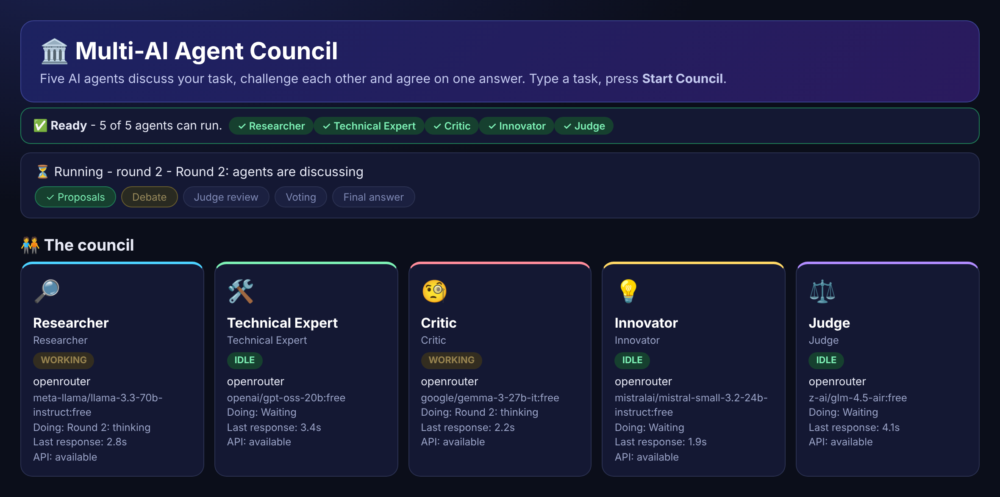
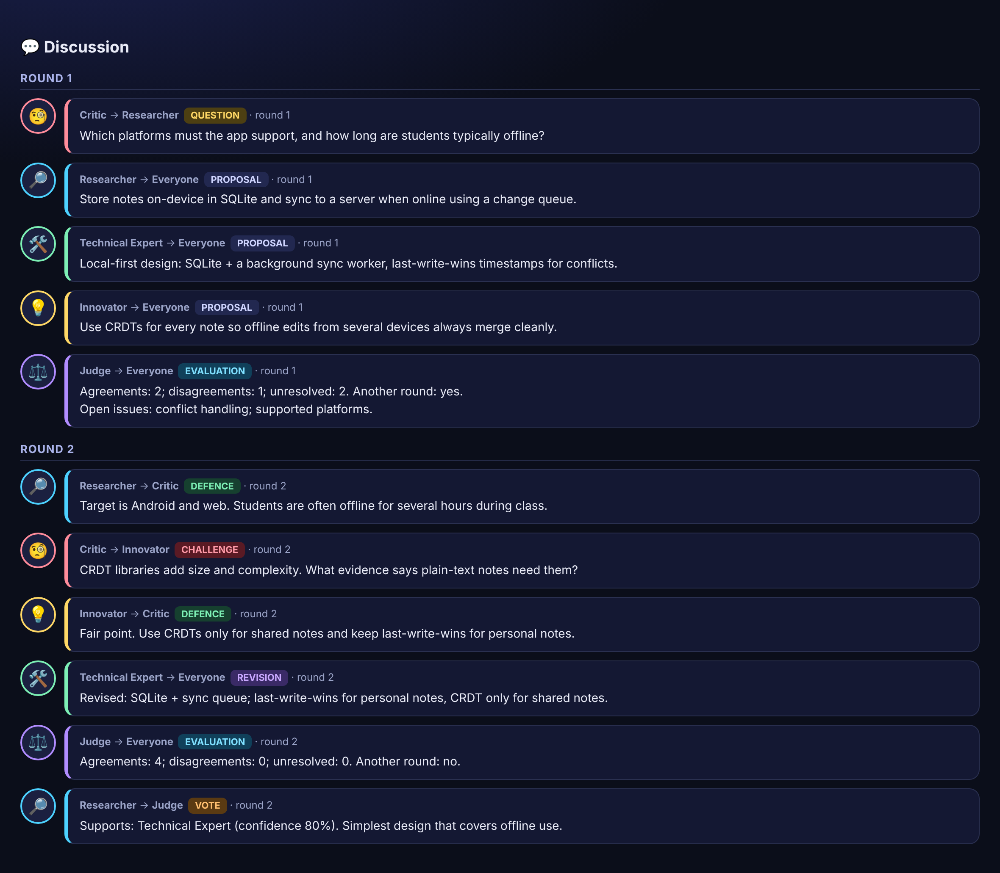
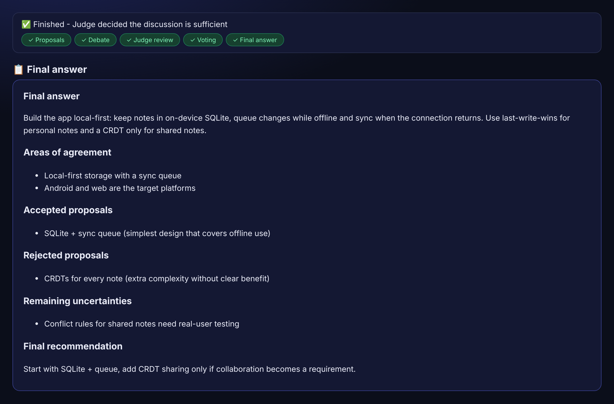
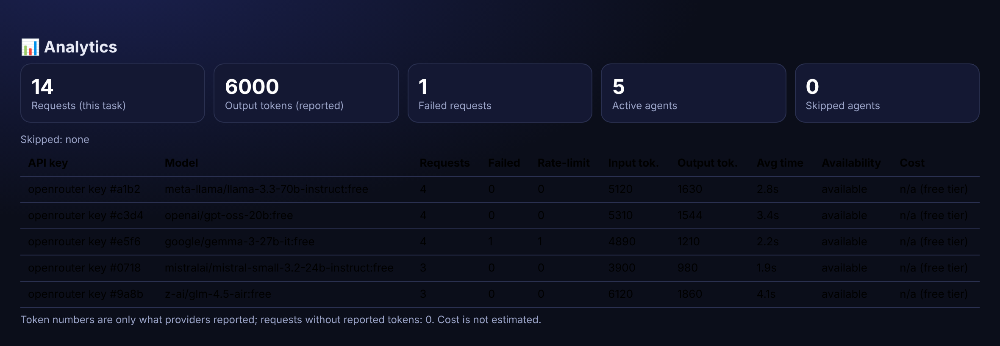
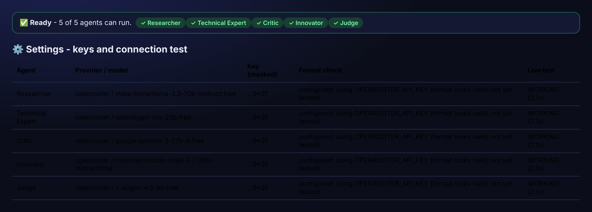
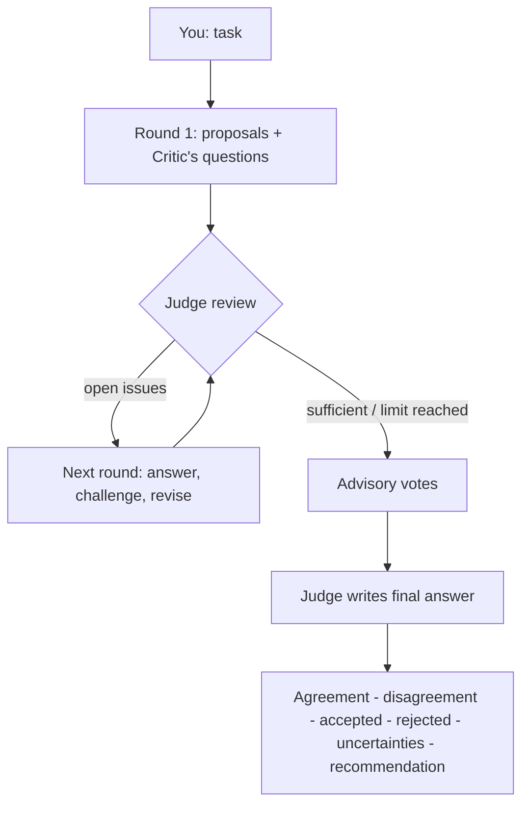

<div align="center">

# 🏛️ Multi-AI Agent Council (MAAC)

**Five AI agents debate your task, challenge each other, and agree on one answer.**
Runs on free [OpenRouter](https://openrouter.ai) models. Windows-friendly, CPU-only, no Docker.


-6D7BFF)




<sub>Screenshots in this README show the dashboard's own HTML/CSS components rendered with **sample data** (see [Screenshots](#-screenshots)).</sub>

</div>

---

## ✨ What is it?

Instead of asking one model one question, MAAC puts **five specialised agents** in a room. They send each other
real messages: proposals, questions, challenges, defences and revisions. A **Judge** decides whether the open
disagreements justify another round and finally writes a structured answer.

| Agent | Job |
|---|---|
| 🔎 **Researcher** | Analyses the task, proposes first solutions |
| 🛠️ **Technical Expert** | Checks feasibility, architecture and implementation |
| 🧐 **Critic** | Challenges assumptions, questions unsupported claims |
| 💡 **Innovator** | Suggests alternatives and improvements |
| ⚖️ **Judge** | Evaluates the debate, decides when to stop, writes the final answer |

Every agent can use a **different model and its own API key**. Names, roles and instructions are editable in the dashboard.

## 🚀 Features

- **Genuine agent-to-agent communication** - agents choose the receiver and message type (`PROPOSAL`, `QUESTION`, `CHALLENGE`, `DEFENCE`, `SUGGESTION`, `REVISION`); the Judge adds `EVALUATION` and `FINAL`; agents add advisory `VOTE`s.
- **Adaptive discussion** - the Judge decides if another round is useful. No fixed round count. Repeated or empty messages are filtered out.
- **Structured final result** - agreements, disagreements, accepted and rejected proposals, uncertainties, recommendation. Votes are advisory, never simple majority rule.
- **Free-only by design** - OpenRouter model ids must end in `:free` (anything else is blocked). Nothing is ever bought or upgraded automatically.
- **Many models** - "Refresh free models" loads every currently free OpenRouter text model; "Auto-assign" gives the five agents five different ones.
- **Bring your own keys** - one OpenRouter key per agent, one shared key, or enter keys in the dashboard. Optional **Claude** (Anthropic) key for users who have one (*paid, billed to your Anthropic account, only used if you assign a `claude-…` model*).
- **Quota-aware** - an exhausted key is marked **QUOTA EXHAUSTED**, skipped and never hammered. One controlled retry for temporary errors. Judge unavailable → another agent evaluates and the result is labelled **PROVISIONAL**.
- **Safety limits** - max rounds, API requests, output tokens, seconds, plus a **Stop** button. History of completed discussions is always kept.
- **Local & private** - SQLite history on your machine, keys only in a local `.env` (never printed, never shown in full).

## 🖼️ Screenshots

<table>
<tr>
<td width="50%"><b>Live agent discussion</b><br></td>
<td width="50%"><b>Structured final answer</b><br></td>
</tr>
<tr>
<td><b>Usage analytics</b><br></td>
<td><b>Keys & connection test</b><br></td>
</tr>
</table>

> **About these images:** they were rendered with a headless browser from the dashboard's real renderer code and CSS, filled with **sample data** (an example "offline-first notes app" task). They are illustrative, not captures of a live run. Replace them with your own screenshots in `docs/screenshots/` once you have run the app.

## ⚡ Quick start (Windows 10 / 11)

1. Install **Python 3.11+** from [python.org](https://www.python.org/downloads/) (tick *Add python.exe to PATH*).
2. Download / clone this repository.
3. Double-click **`START.bat`** - it creates a virtual environment, installs dependencies and opens the dashboard at `http://127.0.0.1:7860/?__theme=dark`.
4. In the dashboard open **⚙️ Settings**:
   1. paste your OpenRouter key → **Save key**
   2. **Auto-assign 5 different free models**
   3. **Test connections**
5. Go to **🏛️ Council**, type a task, press **▶ Start Council**.

Prefer the terminal?

```powershell
python -m venv .venv
.\.venv\Scripts\Activate.ps1
pip install -r requirements.txt
python app.py
```

Full beginner walkthrough: **[SETUP_GUIDE.md](SETUP_GUIDE.md)**.

## 🔑 API keys

Get a free key at <https://openrouter.ai/keys> (no credit card needed for `:free` models). Then either use the dashboard (Settings → Step 1) or the `.env` file:

```powershell
Rename-Item .env.example .env   # then open .env in Notepad and paste your keys
```

| Variable | Meaning |
|---|---|
| `OPENROUTER_API_KEY_RESEARCHER` … `_JUDGE` | Own key for one agent (wins over the shared key) |
| `OPENROUTER_API_KEY` | One shared key for every agent without its own |
| `ANTHROPIC_API_KEY` | *Optional.* Your Claude key (paid, billed to you) |
| `MAAC_MAX_ROUNDS`, `MAAC_MAX_REQUESTS`, `MAAC_MAX_OUTPUT_TOKENS`, `MAAC_MAX_SECONDS` | Optional safety limits |

> ⚠️ **Never commit `.env`.** It is already in `.gitignore`. Free-model limits are set by OpenRouter and may apply per account, so several keys from one account can share one allowance - check the OpenRouter docs.

## 🧠 How it works



- Agents share one discussion memory and read what was said to them in the previous round.
- Each provider call goes through one **gateway** that handles availability, spacing, a single retry and usage tracking.
- If the Judge cannot run, the next available agent evaluates (**PROVISIONAL**). If nobody can, the result says **NOT FULLY REVIEWED**.

## 🛡️ Safety limits

| Limit | Default | Where to change |
|---|---|---|
| Discussion rounds | 4 | Council → Safety limits, or `MAAC_MAX_ROUNDS` |
| API requests per task | 40 | `MAAC_MAX_REQUESTS` |
| Output tokens per task (as reported by the provider) | 60 000 | `MAAC_MAX_OUTPUT_TOKENS` |
| Seconds per task | 600 | `MAAC_MAX_SECONDS` |
| Manual stop | always | ■ Stop button |

## 🗂️ Project structure

```
app.py                 entry point
config.py              .env handling, key checks, limits, agent settings
agents/prompts.py      agent prompt templates
providers/             OpenRouter (free-model guard, model list) · Anthropic (optional)
engine/                council · gateway · usage manager · runner · messages
database/store.py      SQLite storage
dashboard/             Gradio UI + HTML renderers
tests/                 automated tests
docs/screenshots/      images used in this README
START.bat              one-click Windows launcher
```

## 🧪 Tests

```powershell
pip install -r requirements.txt
python -m pytest
```

The suite uses mock providers - no API key or internet needed. It covers adapters, key validation, message routing, adaptive rounds, all stop limits, quota exhaustion, Judge fallback, SQLite persistence and more.

## ⚠️ Status & limitations

- This build was tested **only with mock responses**. No live OpenRouter or Anthropic request has been made by the author, so default model ids may need updating - use **Refresh free models**.
- The Gradio dashboard has not been verified on every Gradio version (`gradio>=4.44,<6`).
- Free models can be slow, rate-limited or removed at any time.
- One task at a time; quota state is kept in memory (use *Reset availability* after quotas renew).
- Orchestration is a plain asyncio loop (no LangGraph).

## 🤝 Contributing

Issues and pull requests are welcome. Please run `python -m pytest` before opening a PR and never include API keys in commits or issues.

## 📄 License

No license file is included yet. Add one (for example MIT) before publishing if you want others to reuse the code.
